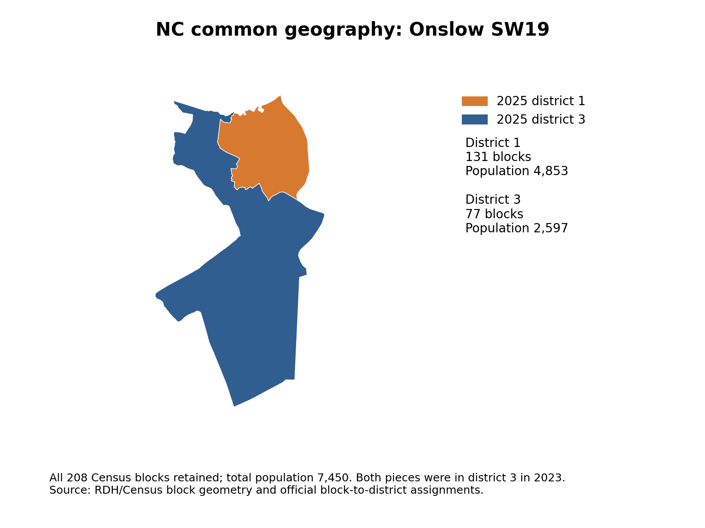
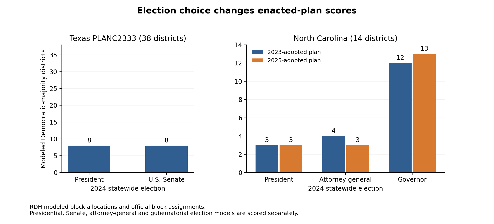
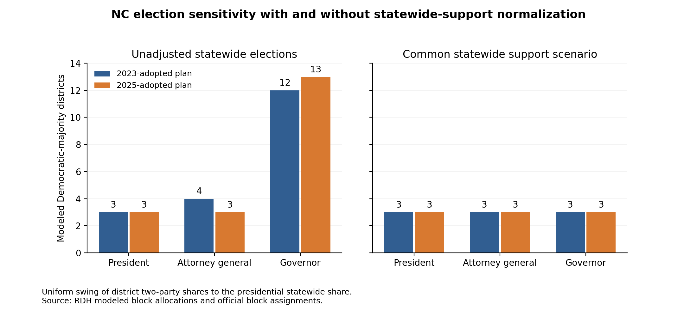

# Texas and North Carolina: source data and geography

November 2026. Research advised by Dr. Eric Gerber at Northeastern University.

I reconstructed the Texas and North Carolina inputs from nine Redistricting Data Hub archives. This report records block accounting, geographic construction and election-model comparisons. The [campaign audit](../rebuild-campaign-2026-11-02/README.md) presents the simulations and consolidates the [scientific limitations](../rebuild-campaign-2026-11-02/README.md#limitations).

This analysis was conducted using data from the Redistricting Data Hub. Source pages, archive members, byte counts and SHA-256 hashes are listed in the [source manifest](../../configs/rdh_rebuild_sources_2026-11-02.json). Detailed measurements are in [evidence.json](evidence.json).

## Block accounting

| Measure                                    |      Texas | North Carolina |
| ------------------------------------------ | ---------: | -------------: |
| Unique 2020 Census blocks                  |    668,757 |        236,638 |
| Census P1 total population                 | 29,145,505 |     10,439,388 |
| Modeled 2024 Harris votes                  |  4,835,134 |      2,713,609 |
| Modeled 2024 Trump votes                   |  6,393,403 |      2,896,942 |
| Population blocks missing election records |          0 |              0 |
| Election blocks missing population records |          0 |              0 |
| Official plan assignments missing blocks   |          0 |              0 |
| Zero-population blocks retained            |    219,672 |         61,650 |

Block IDs were checked for state FIPS, length and uniqueness. The Census, election and official assignment files have identical block sets within each state. Independent execution through the state CLI reproduced the block-master CSVs byte for byte.

Texas PLANC2333 scores **8 Democratic-majority districts** under the modeled presidential votes. Its official block assignment splits 427 precincts; scoring remains at block resolution. Maximum district population deviation is approximately 0.00012695%.

Both NC maps score **3 Democratic-majority districts** with the same presidential vote allocation. Between 2023 and 2025, 18,826 blocks change districts, containing population 543,381 and modeled votes 117,023 Democratic / 177,741 Republican.

## Election totals and source versions

RDH allocates precinct votes to Census blocks using modified voting-age population, precinct membership procedures and integer rounding. Population is measured in 2020 and the elections in 2024. The zero-population audit retains 65 Texas blocks with positive modeled presidential allocations, totaling 543 Democratic and 450 Republican votes. NC has no such allocations in its zero-population blocks.

Texas block totals match the RDH precinct presidential counts exactly. The [November 25, 2024 Texas certificate](https://www.archives.gov/files/electoral-college/2024/ascertainment-texas.pdf) has 116 more Harris votes and 194 more Trump votes. RDH's precinct metadata notes small differences from the official canvass.

NC's block allocation contains one more Trump vote than its precinct file, at `WAKE-:-16-09`. RDH documents a mixture of precinct-sorted and unsorted election inputs. [NCSBE explains](https://www.ncsbe.gov/results-data/election-results/historical-election-results-data) that the sorted files contain privacy noise.

| NC source snapshot                                 |    Harris |     Trump |
| -------------------------------------------------- | --------: | --------: |
| RDH modeled block allocation                       | 2,713,609 | 2,896,942 |
| NCSBE unsorted file, modified December 3, 2024     | 2,715,375 | 2,898,423 |
| November 26 certification / December 9 certificate | 2,715,378 | 2,898,424 |

The [unsorted file](https://s3.amazonaws.com/dl.ncsbe.gov/ENRS/2024_11_05/results_pct_20241105.zip) differs from RDH in 27 counties, with net differences of 1,766 Harris and 1,481 Trump votes. Summed absolute county differences are 1,794 and 1,495, respectively. Both positive and negative differences occur. The [November 26 certification](https://s3.amazonaws.com/dl.ncsbe.gov/State_Board_Meeting_Docs/2024-11-26/Canvass/Certification%20of%20State%20Jurisdiction%20Contests%20112624.pdf) and [December 9 certificate](https://www.archives.gov/files/electoral-college/2024/ascertainment-north-carolina.pdf) differ from the unsorted snapshot by another 3 Harris and 1 Trump votes. The reconstruction retains the RDH values without redistribution.

Provider metadata contains two apparent template errors: the NC precinct README's first line says 2022 despite its 2024 fields, and the Texas Census dataset page mentions Ohio. File identity was checked against state-coded IDs, candidate fields, population totals and source URLs.

## Texas geographic construction

The 9,712-unit source precinct and congressional layers each contain five ring self-intersections and eight positive-area overlap pairs. The largest overlap is approximately 0.198461 m².

I applied `shapely.make_valid` to five polygons in the derived candidate: `121-4222`, `295-0106`, `401-0416`, `453-0152` and `479-0252`. The source archive is pinned by checksum. Each repair produces a valid Polygon with zero measured Hausdorff boundary displacement; the largest absolute area change is approximately 7.16 × 10⁻⁷ m².

The candidate retains all units, blocks, population and votes. GerryChain and positive shared-boundary adjacency agree on all 26,860 graph edges. The graph is connected, all 38 prior-map districts are contiguous, and the starting population deviation is 0.0524163%. The eight source overlap pairs remain in the candidate.

## North Carolina geographic construction

The all-races precinct layer has 2,658 valid polygons and zero positive-area overlaps. The congressional-split layer has 2,678 valid polygons and 44 overlap pairs, the largest approximately 3.13 × 10⁻⁸ m².

The common precinct-based candidate has 2,681 units, both district assignments and exact block totals. It has 57 overlap pairs and an Onslow coverage residual of approximately 0.001211 m². Its GerryChain graph has 7,584 edges, versus 7,581 under positive shared-boundary adjacency. In-memory coordinate-rounding scenarios produce 7,592–7,598 edges; the candidate retains the original coordinates.

The primary geography instead unions all 236,638 Census blocks by their precinct / 2023 / 2025 membership. It retains the same 2,681 IDs, block counts, populations, modeled votes and assignments. All units are valid and nonempty, overlaps and isolates are zero, and both plans are contiguous. GerryChain and positive shared-boundary adjacency agree on 7,581 edges.

The two graphs differ by **47 edges**: 25 precinct-only and 22 block-union-only. The sum of unitwise symmetric-difference areas is 774,347 m², with a maximum of 155,680 m². This sum counts transferred territory more than once. The block-union geometry is the baseline; the precinct geometry is a separate sensitivity condition.



Onslow SW19 contains 208 blocks and population 7,450. The 2025 district-1 piece contains 131 blocks, population 4,853 and modeled votes 805 Democratic / 2,116 Republican. The district-3 piece contains 77 blocks, population 2,597 and votes 434 / 1,146. Both pieces belonged to district 3 in 2023.

## Enacted-plan election sensitivity



Texas PLANC2333 scores 8 Democratic-majority districts using either presidential or Senate votes. The Senate model's smallest two-party margin is 224 modeled votes. A +1 percentage-point Democratic uniform swing produces 10 districts in the Senate model and 8 in the presidential model.

NC's 2023 / 2025 maps score 3 / 3 using presidential votes, 4 / 3 using attorney-general votes, and 12 / 13 using gubernatorial votes. Normalizing each election to the presidential statewide two-party share with a uniform swing produces 3 / 3 for all three models.



## Continuation and software

Version-2 checkpoints record dataset and graph fingerprints, sampler source hashes, parameters, software versions, seed, assignment and RNG state. Stable cut-edge, spanning-tree input and district iteration make reconstructed continuations reproducible. Texas, NC and a synthetic-grid check each matched complete CSV records for uninterrupted 120-state and split 100+20-state runs. Legacy checkpoints lack the required provenance fields.

The research environment uses Python 3.12.16 and the [pinned dependency set](../../requirements-research-macos-arm64-py312.txt). The [state CLI guide](../../docs/state_cli.md) covers the workflow. Source-validation and construction commands follow; each output directory must be new.

```sh
export MPLCONFIGDIR="$PWD/data/external/rdh/rebuild_2026-11-02/runtime/matplotlib312"
export TMPDIR="$PWD/.venv/test-runtime"
export UV_CACHE_DIR="$PWD/.venv/uv-cache"
MPLCONFIGDIR="$MPLCONFIGDIR" TMPDIR="$TMPDIR" .venv/science/bin/python -m unittest discover -s tests -v
.venv/bin/uv pip check --python .venv/science/bin/python
python3 src/validation/audit_rdh_sources.py --state north_carolina --source-root data/external/rdh/rebuild_2026-11-02 --output-dir outputs/analysis/rdh_rebuild_2026-11-02/nc_block_audit
python3 src/validation/audit_rdh_sources.py --state texas --source-root data/external/rdh/rebuild_2026-11-02 --output-dir outputs/analysis/rdh_rebuild_2026-11-02/tx_block_audit
.venv/science/bin/python main.py --nc --stage validate --source-root data/external/rdh/rebuild_2026-11-02 --report-dir outputs/analysis/rdh_cli_validation_2026-11-02/nc
.venv/science/bin/python main.py --texas --stage validate --source-root data/external/rdh/rebuild_2026-11-02 --report-dir outputs/analysis/rdh_cli_validation_2026-11-02/tx
.venv/science/bin/python src/data_prep/rebuild_nc_common.py --source-root data/external/rdh/rebuild_2026-11-02 --block-master outputs/analysis/rdh_rebuild_2026-11-02/nc_block_audit/blocks_master.csv --output-dir outputs/analysis/rdh_rebuild_2026-11-02/nc_common_candidate
.venv/science/bin/python src/data_prep/rebuild_texas_candidate.py --source-root data/external/rdh/rebuild_2026-11-02 --block-master outputs/analysis/rdh_rebuild_2026-11-02/tx_block_audit/blocks_master.csv --output-dir outputs/analysis/rdh_rebuild_2026-11-02/tx_candidate
.venv/science/bin/python src/data_prep/rebuild_nc_block_union.py --source-root data/external/rdh/rebuild_2026-11-02 --block-master outputs/analysis/rdh_rebuild_2026-11-02/nc_block_audit/blocks_master.csv --output-dir outputs/analysis/rdh_rebuild_2026-11-02/nc_block_union_candidate
.venv/science/bin/python src/validation/audit_adjacency_sensitivity.py --dataset outputs/analysis/rdh_rebuild_2026-11-02/nc_block_union_candidate/nc_block_union_candidate.gpkg --output outputs/analysis/rdh_rebuild_2026-11-02/nc_block_union_adjacency.json
.venv/science/bin/python src/analysis/audit_nc_precision_sensitivity.py --dataset outputs/analysis/rdh_rebuild_2026-11-02/nc_common_candidate/nc_common_candidate.gpkg --output outputs/analysis/rdh_rebuild_2026-11-02/nc_precision_sensitivity.json
.venv/science/bin/python src/validation/audit_nc_official_returns.py --official-zip data/external/ncsbe/rebuild_2026-11-02/results_pct_20241105.zip --block-master outputs/analysis/rdh_rebuild_2026-11-02/nc_block_audit/blocks_master.csv --output outputs/analysis/rdh_rebuild_2026-11-02/nc_official_county_comparison.json
.venv/science/bin/python src/analysis/plot_source_audit.py --audit-root outputs/analysis/rdh_rebuild_2026-11-02 --output-dir deliverables/rdh-research-audit-2026-11-02/figures_source
.venv/science/bin/python main.py --nc --config configs/research_rebuild_2026-11-02.json
.venv/science/bin/python main.py --texas --config configs/research_rebuild_2026-11-02.json
```

```sh
.venv/science/bin/python src/validation/check_continuation.py --dataset outputs/analysis/rdh_rebuild_2026-11-02/nc_block_union_candidate/nc_block_union_candidate.gpkg --assignment-col CONG_DIST --epsilon 0.005 --seed 707 --output-dir outputs/analysis/rdh_rebuild_2026-11-02/nc_continuation_probe_v3
.venv/science/bin/python src/validation/check_continuation.py --dataset outputs/analysis/rdh_rebuild_2026-11-02/tx_candidate/tx_candidate.gpkg --assignment-col CONG_DIST --epsilon 0.001 --seed 1117 --output-dir outputs/analysis/rdh_rebuild_2026-11-02/tx_continuation_probe_v3
```
