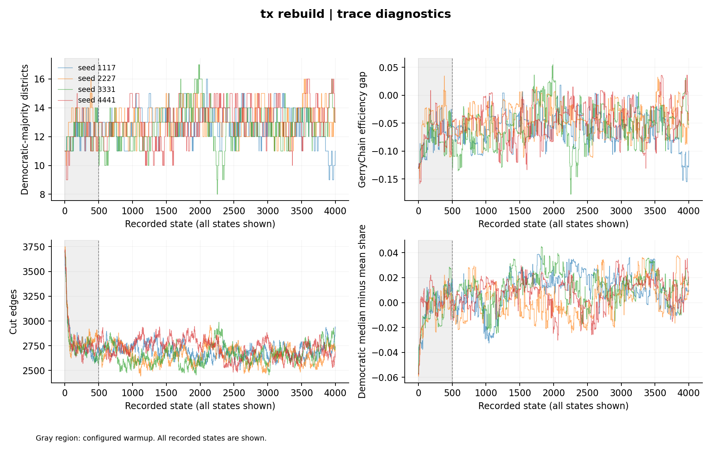
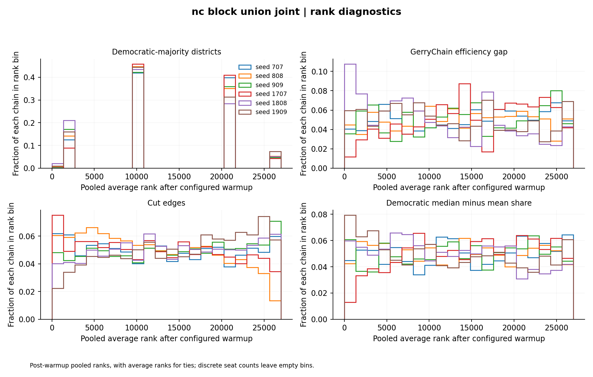
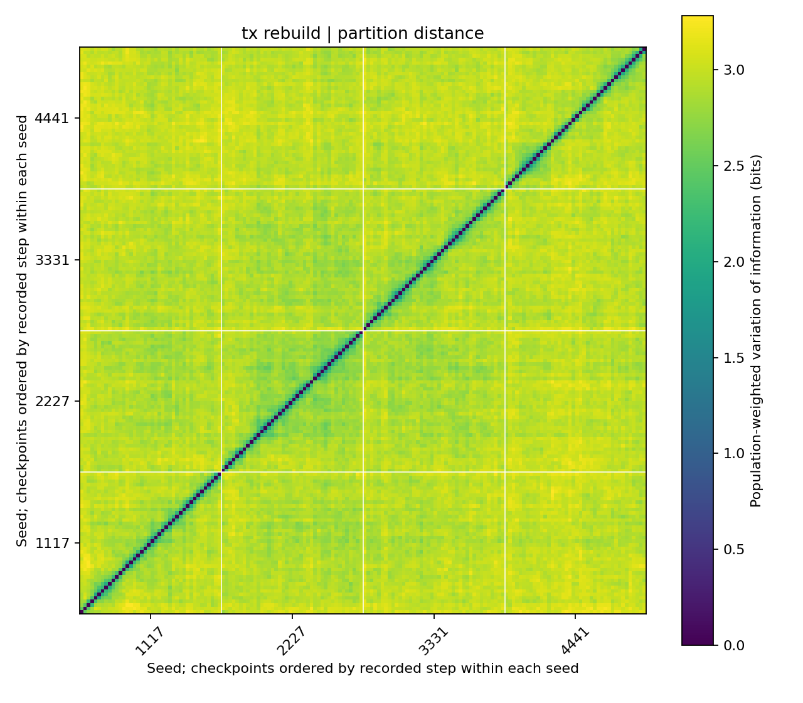
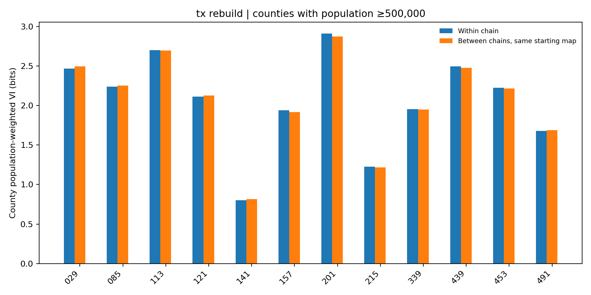

# Texas and North Carolina: November 2026 campaign

Research advised by Dr. Eric Gerber, Northeastern University.

I ran this initial campaign before the continued baselines summarized in the [project README](../../README.md). I ran 26 chains across eight baseline and sensitivity conditions, producing 122,000 recorded states. The primary analysis retains 109,000 states after 500 warmup states per chain. All 44 primary metric/group combinations fall below their bulk-ESS screen. The [source audit](../rdh-research-audit-2026-11-02/README.md) describes the data and geographic construction.

This analysis was conducted using data from the Redistricting Data Hub.

## Campaign design

| Condition                        | Starting maps                        |   Chains × states | Population bound |
| -------------------------------- | ------------------------------------ | ----------------: | ---------------: |
| Texas baseline                   | Prior congressional map              |         4 × 4,000 |            ±0.1% |
| Texas population sensitivity     | Same prior map                       |         4 × 4,000 |            ±0.5% |
| NC block-union baseline          | 2023 and 2025                        | 3 × 5,000 per map |            ±0.5% |
| NC precinct-geometry sensitivity | 2023 and 2025                        | 3 × 5,000 per map |            ±0.5% |
| NC population sensitivity        | 2023 and 2025, block-union geography | 3 × 5,000 per map |              ±1% |

I record the chain additions in the [workflow](../../docs/research_workflow.md) and [campaign manifest](campaign_manifest.json). I used distinct seeds across NC starting maps within each condition and reused labels for sensitivity conditions, which I analyzed separately. Warmup views are 0, 250, 500 and 1,000 states; the primary view uses 500. States are recorded without thinning.

I used cut-edge choice and random-MST ReCom proposals with `node_repeats=2`, `max_attempts=1000`, pair reselection, population bounds, graph contiguity and always-accept for valid proposals. The [executed registries](executed_state_registries.json) and manifest contain the seeds, commands, dataset fingerprints and parameters.

## Convergence results

I screened the runs with rank-normalized split R-hat below 1.01 and bulk/tail ESS of at least `max(400, 100 × chains)`: 400 for the separate Texas and NC groups, and 600 for six-chain NC combinations.

| Condition                | Chains | Seat R-hat | Bulk ESS | Tail ESS | Mean MCSE (seats) |
| ------------------------ | -----: | ---------: | -------: | -------: | ----------------: |
| Texas baseline ±0.1%     |      4 |    1.03644 |    100.9 |    145.5 |            0.1198 |
| Texas sensitivity ±0.5%  |      4 |    1.12480 |     24.6 |    150.6 |            0.2518 |
| NC block-union / 2023    |      3 |    1.00924 |    210.3 |    553.4 |            0.0556 |
| NC block-union / 2025    |      3 |    1.01485 |    231.3 |    292.6 |            0.0547 |
| NC block-union / jointly |      6 |    1.01135 |    451.8 |    758.1 |            0.0385 |
| NC precinct / 2023       |      3 |    1.03460 |    119.9 |    239.5 |            0.0744 |
| NC precinct / 2025       |      3 |    1.01551 |    214.4 |    369.1 |            0.0578 |
| NC precinct / jointly    |      6 |    1.02705 |    319.9 |    573.0 |            0.0465 |
| NC ±1% / 2023            |      3 |    1.02876 |    223.7 |    313.3 |            0.0593 |
| NC ±1% / 2025            |      3 |    1.01194 |    165.0 |    315.9 |            0.0667 |
| NC ±1% / jointly         |      6 |    1.01897 |    365.2 |    599.9 |            0.0447 |

I recorded four metrics: Democratic-majority district count, efficiency gap, cut edges and Democratic median-minus-mean vote share. [Primary results](primary_diagnostics.csv), [all 176 metric/warmup views](diagnostics.csv), and [diagnostic estimates and flags](diagnostics.json) are available as data files. All 1,232 core numerical estimates are finite.

Texas baseline cut-edge R-hat is 1.13644, bulk ESS 27.7, and mean MCSE 17.45 edges. Its mean–median R-hat is 1.05979 with bulk ESS 47.3. Combined primary NC efficiency-gap R-hat is 1.02543 with bulk ESS 294.8.



Across warmup settings 0, 250, 500 and 1,000, primary NC joint seat bulk ESS is 487.7, 464.3, 451.8 and 401.4. Corresponding R-hat values are 1.00876, 1.01200, 1.01135 and 1.01280. Texas baseline seat bulk ESS remains below 400 at every warmup setting.

The [22 trace/rank figures](figures/README.md) cover all eight conditions and the three compatible NC joint groups. Traces show all recorded states; rank plots use average ranks for ties. [Chain summaries](chain_summary.csv) include autocorrelations and first/last-window changes, with the full [window table](windows.csv) available separately.



## Enacted-score tail counts

PLANC2333 scores 8 Democratic-majority districts using the official block assignment and modeled presidential votes. The Texas baseline contains **4 of 14,000 retained states with 8 districts**, all from seed 3331 at steps 2,253, 2,256, 2,257 and 2,258. Their plan hashes are distinct. I observed 8–17 districts in this baseline, including plans matching the PLANC2333 score.

I replayed steps 2,200–2,258 from the stored checkpoint and matched all 59 CSV records exactly. The four target assignments have different recomputed cut-edge fingerprints, and all six pairwise unit-weighted partition distances are positive. Independent scoring gives 8 Democratic-majority districts for each assignment; each satisfies the existing population and graph-contiguity constraints. The [assignment table](tail_assignment_check/plan_assignments.csv), [verification results and commands](tail_assignment_check/assignment_verification.json), and [replay configuration](tail_assignment_check/state.json) record the check. These replayed records are excluded from the ensemble counts.

The Texas wider-tolerance condition has zero states at or below 8 out of its own 14,000 retained states. Its constant indicator produces nonfinite R-hat at every warmup setting; ArviZ reports MCSE zero and ESS equal to draw count for that indicator.

NC's primary graph has 193 of 27,000 retained states at or below the enacted score of 3 districts: 58 from 2023 starts and 135 from 2025 starts. The precinct-geometry and wider-tolerance conditions have 304 and 300 such states, respectively, each out of 27,000 retained states. [Per-chain counts](enacted_tail_counts.csv) and [indicator diagnostics](enacted_tail_diagnostics.json) retain each condition separately.

## Constraint and geographic sensitivity

Texas seat bulk ESS is 24.6 in the ±0.5% condition; NC joint seat bulk ESS is 365.2 in the ±1% condition. Both also fail the R-hat screen.

Sensitivity-minus-baseline mean seat differences are +0.13093 for Texas's population bound; +0.05563 / −0.05667 for NC precinct geometry from 2023 / 2025 starts; and −0.06667 / +0.04400 for NC's wider population bound. NC 2025-minus-2023 mean differences are −0.04022 on the block-union graph and −0.15252 on the precinct graph.

I examined all 1,220 saved checkpoints. The geographic summary measures each county's population fraction assigned to districts with a modeled Democratic presidential majority. It includes zero-population units and every saved checkpoint, with separate post-warmup summaries.

Among Texas counties above 500,000 population, the largest baseline across-seed ranges in the mean population fraction are:

| Texas county FIPS suffix | Population | Across-seed range in checkpoint mean population fraction |
| ------------------------ | ---------: | -------------------------------------------------------: |
| 491                      |    609,017 |                                                   0.3380 |
| 029                      |  2,009,324 |                                                   0.0992 |
| 453                      |  1,290,188 |                                                   0.0838 |
| 439                      |  2,110,640 |                                                   0.0745 |
| 201                      |  4,731,145 |                                                   0.0659 |

FIPS suffixes 491, 029, 453, 439 and 201 correspond to Williamson, Bexar, Travis, Tarrant and Harris counties. Williamson's range is 33.8 percentage points. Harris's last-ten minus first-ten checkpoint mean changes range from +0.0091 to +0.1879 across baseline chains; Dallas includes changes in opposing directions. The [county summaries](county_chain_summary.csv), [across-chain ranges](county_chain_ranges.csv) and [checkpoint fingerprints](geography_audit.json) locate these differences.

## Partition comparison

I compared every saved district assignment using [variation of information](https://doi.org/10.1016/j.jmva.2006.11.013), a label-invariant partition measure, in bits. The analysis covers 1,220 checkpoints and 159,990 pairs. Each condition has separate unit-weighted and population-weighted measures; the unit measure includes zero-population units, while their population weight is zero.

For checkpoint pairs at least 2,000 states apart after the configured warmup, mean population-weighted distances are:

| Condition      | Within chain | Between chains, same starting map | Between starting maps |
| -------------- | -----------: | --------------------------------: | --------------------: |
| Texas baseline |      2.93988 |                           2.95174 |                   n/a |
| Texas ±0.5%    |      2.96859 |                           2.98761 |                   n/a |
| NC block-union |      2.62961 |                           2.63198 |               2.63028 |
| NC precinct    |      2.57550 |                           2.58450 |               2.58389 |
| NC ±1%         |      2.60352 |                           2.60076 |               2.59967 |

The lag distributions match across these comparison categories. Within-chain and between-chain averages are close, including comparisons between NC starting maps. This summary shows no clear global partition separation between chains, alongside the previously measured county-allocation differences and failed convergence diagnostics.



[All lag-stratified summaries](partition_distances/distance_summary.csv), [distances to the common reference assignment](partition_distances/reference_distances.csv), and [method and input fingerprints](partition_distances/partition_distances.json) accompany the five condition heatmaps. Full pair-level tables remain with the local analysis outputs.

## County partition comparison

The follow-up analysis restricts the partition measure to individual counties. It includes every county with a 2020 population of at least 500,000: 12 in the Texas baseline and three in the NC block-union baseline. The [coverage table](county_partition_distances/county_coverage.csv) records all 354 counties and their selection status. Zero-population units remain in each selected county's unit-weighted measure.

Across 460 saved checkpoints, the analysis makes 287,190 county-restricted pair comparisons. At matched lags of at least 2,000 states after warmup, selected mean population-weighted distances are:

| County               | Within chain | Between chains, same starting map | Between starting maps |
| -------------------- | -----------: | --------------------------------: | --------------------: |
| Williamson, TX (491) |      1.68047 |                           1.68719 |                   n/a |
| Harris, TX (201)     |      2.91204 |                           2.87385 |                   n/a |
| Bexar, TX (029)      |      2.46998 |                           2.49500 |                   n/a |
| Guilford, NC         |      1.31593 |                           1.31436 |               1.31058 |
| Mecklenburg, NC      |      1.97258 |                           1.97215 |               1.96634 |
| Wake, NC             |      2.14245 |                           2.14563 |               2.14413 |

Within-chain and between-chain averages are again close in this summary. The earlier county political-allocation differences therefore do not translate into clear separation under this internal-partition measure.



The [complete contrasts](county_partition_distances/long_lag_contrasts.csv), [all lag summaries](county_partition_distances/county_distance_summary.csv) and [input fingerprints](county_partition_distances/county_partition_distances.json) retain the measured results for every selected county.

## Data checks

Texas retains all 668,757 blocks, population 29,145,505 and 9,712 simulation units. Five ring self-intersections were repaired with `make_valid` in the derived geography. Eight precinct overlap pairs remain, with the largest approximately 0.198461 m². Both graph constructions agree on the candidate adjacency.

NC retains all 236,638 blocks, population 10,439,388 and the common 2,681-unit geography, including Onslow. The block-union baseline has zero overlaps and matching GerryChain/shared-boundary adjacency. The precinct alternative differs by 47 graph edges. Both enacted NC maps score 3 Democratic-majority districts under the modeled presidential votes.

The [adopted-plan polygon audit](adopted_plan_geometry.json) finds valid single polygons and zero positive-area overlaps for the 38 Texas districts and both sets of 14 NC districts. Both NC polygon population fields match the block master exactly. The source audit records election-total discrepancies and enacted-plan election-model comparisons.

## Reproduction and verification

The [manifest](campaign_manifest.json) uses repository-relative paths and retains execution-record hashes. `manifest_sha256` in the audit records identifies the original execution manifest; `publication_manifest_sha256` identifies the portable copy. Source-code, dataset, chain and checkpoint hashes retain their recorded values.

Both state-CLI audits match the corresponding full-audit results. The campaign planner reproduces all 26 scientific definitions. Texas and NC 120-state runs match split 100+20-state continuations exactly. The [verification record](verification.json) contains the software versions and check results; numerical artifact checksums are in the [artifact manifest](artifact_manifest.json), and current README checksums are in the [documentation index](../documentation_checksums.json).

I recorded 62 passing tests without skips for this campaign, together with dependency, formatting, syntax, and whitespace checks. The test record retains the original command output.

Commands below run from the repository root. Existing result directories are protected; choose new output paths when repeating the analysis.

```sh
export MPLCONFIGDIR="$PWD/data/external/rdh/rebuild_2026-11-02/runtime/matplotlib312"
export TMPDIR="$PWD/.venv/test-runtime"
export UV_CACHE_DIR="$PWD/.venv/uv-cache"
.venv/science/bin/python src/chain/run_rebuild_campaign.py --output-dir outputs/analysis/rebuild_campaign_2026-11-02 --workers 4 --run
.venv/science/bin/python src/analysis/audit_rebuild_campaign.py --manifest outputs/analysis/rebuild_campaign_2026-11-02/manifest_with_constraint_sensitivity_v2.json --output-dir outputs/analysis/rebuild_campaign_2026-11-02/final_full_audit
.venv/science/bin/python src/analysis/plot_rebuild_campaign.py --manifest outputs/analysis/rebuild_campaign_2026-11-02/manifest_with_constraint_sensitivity_v2.json --output-dir outputs/analysis/rebuild_campaign_2026-11-02/final_full_figures
.venv/science/bin/python src/analysis/audit_checkpoint_geography.py --manifest outputs/analysis/rebuild_campaign_2026-11-02/manifest_with_constraint_sensitivity_v2.json --output-dir outputs/analysis/rebuild_campaign_2026-11-02/final_checkpoint_geography
.venv/science/bin/python src/analysis/audit_enacted_tail.py --manifest outputs/analysis/rebuild_campaign_2026-11-02/manifest_with_constraint_sensitivity_v2.json --audit-root outputs/analysis/rdh_rebuild_2026-11-02 --output-dir outputs/analysis/rebuild_campaign_2026-11-02/enacted_tail_audit
.venv/science/bin/python src/validation/audit_adopted_plan_geometry.py --source-root data/external/rdh/rebuild_2026-11-02 --audit-root outputs/analysis/rdh_rebuild_2026-11-02 --output-dir outputs/analysis/rdh_rebuild_2026-11-02/adopted_plan_geometry
.venv/science/bin/python main.py --nc --config configs/research_rebuild_2026-11-02.json --stage research-audit --campaign-manifest outputs/analysis/rebuild_campaign_2026-11-02/manifest_with_constraint_sensitivity_v2.json --report-dir outputs/analysis/rebuild_campaign_2026-11-02/state_cli_nc_full_audit
.venv/science/bin/python main.py --texas --config configs/research_rebuild_2026-11-02.json --stage research-audit --campaign-manifest outputs/analysis/rebuild_campaign_2026-11-02/manifest_with_constraint_sensitivity_v2.json --report-dir outputs/analysis/rebuild_campaign_2026-11-02/state_cli_tx_full_audit
.venv/science/bin/python src/chain/run_rebuild_campaign.py --output-dir outputs/analysis/rebuild_campaign_replay_check_2026-11-02
.venv/science/bin/python src/analysis/audit_partition_distances.py --manifest outputs/analysis/rebuild_campaign_2026-11-02/manifest_with_constraint_sensitivity_v2.json --checkpoint-audit outputs/analysis/rebuild_campaign_2026-11-02/final_checkpoint_geography/geography_audit.json --output-dir outputs/analysis/partition_distances_2026-11-02
.venv/science/bin/python src/analysis/audit_county_partition_distances.py --manifest outputs/analysis/rebuild_campaign_2026-11-02/manifest_with_constraint_sensitivity_v2.json --checkpoint-audit outputs/analysis/rebuild_campaign_2026-11-02/final_checkpoint_geography/geography_audit.json --global-analysis-dir outputs/analysis/partition_distances_2026-11-02 --output-dir outputs/analysis/county_partition_distances_2026-11-02
.venv/science/bin/python -m unittest discover -s tests -v
.venv/bin/uv pip check --python .venv/science/bin/python
```

## Limitations

MCSE estimates assume adequate sampling, and acceptance criteria for MCSE and window stability still need to be specified. The four Texas tail observations occur within six steps of one chain; descriptive frequencies are not calibrated p-values. Zero observed outcomes or a constant indicator's zero MCSE leave the event probability and uncertainty unresolved. Snapshot-based geographic summaries and similar condition means leave sampler connectivity, causal constraint effects, and distributional equivalence unresolved. Partition-distance pairs share plans and are dependent; their count is not an effective sample size. Variation of information compares membership rather than physical boundary displacement, and its global averages can mask localized differences. County-restricted distances compare internal grouping and do not measure which outside units are joined to a county.

RDH block votes are modeled allocations rather than observed block returns. Election-source differences, NC privacy noise, candidate strength and the uniform-swing assumption affect interpretation. Population and election years differ. Alternative-election scoring has been evaluated on enacted maps, but not across the full ensemble.

Texas's eight precinct overlaps and broader starting-map sensitivity remain unresolved. NC geography inherits RDH block-to-precinct membership assumptions. Physical district-polygon connectedness has been checked, while independent enacted block-graph equivalence remains outstanding. The implemented population/contiguity constraints do not cover the full set of legal and demographic requirements, and ReCom sampling has not been established as uniform over valid maps.

Historical chain files are unavailable, so the earlier analyses cannot be revalidated. The [historical Texas report](../../docs/archive/texas-analysis-before-2026-11-rebuild.md) is superseded by this campaign. I keep these initial results separate from the continued baselines and their freeze records.
