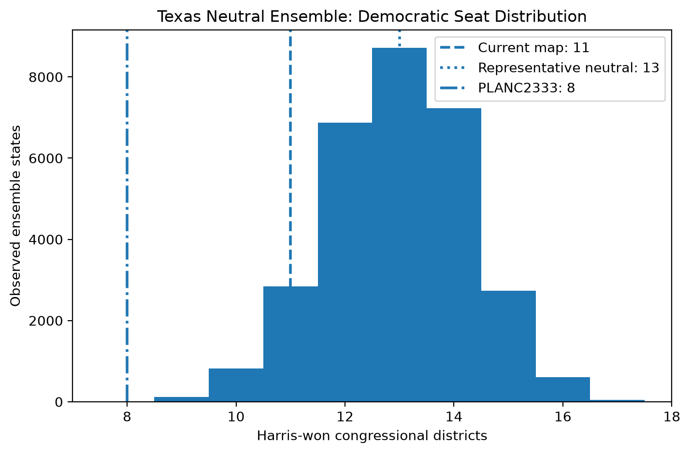
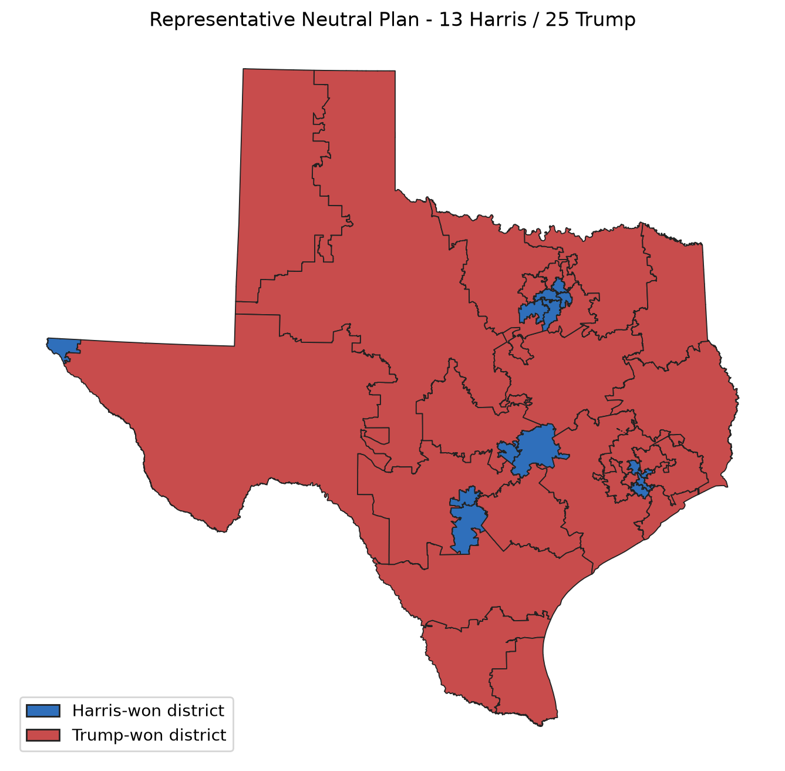
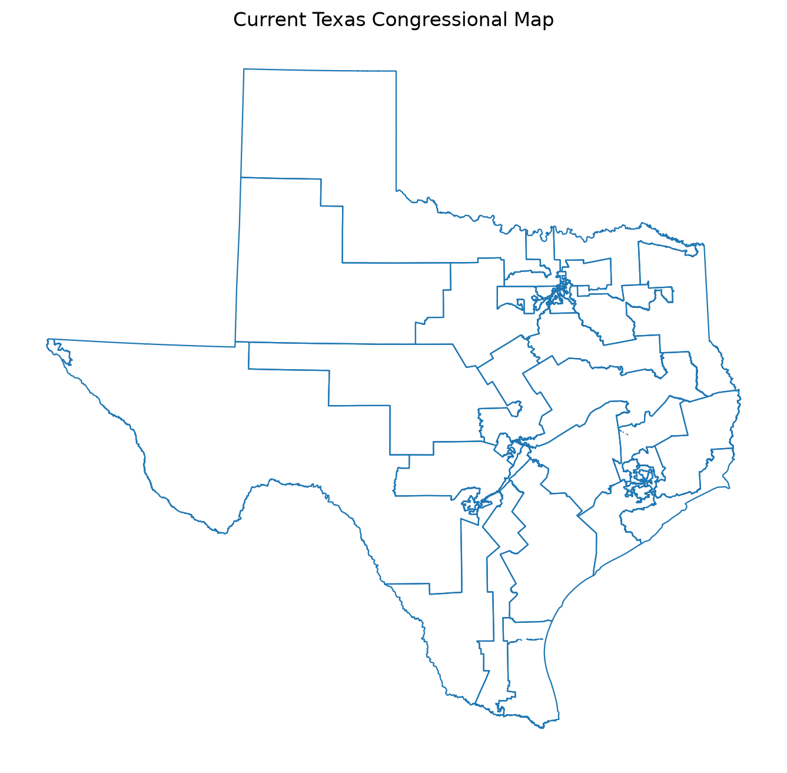
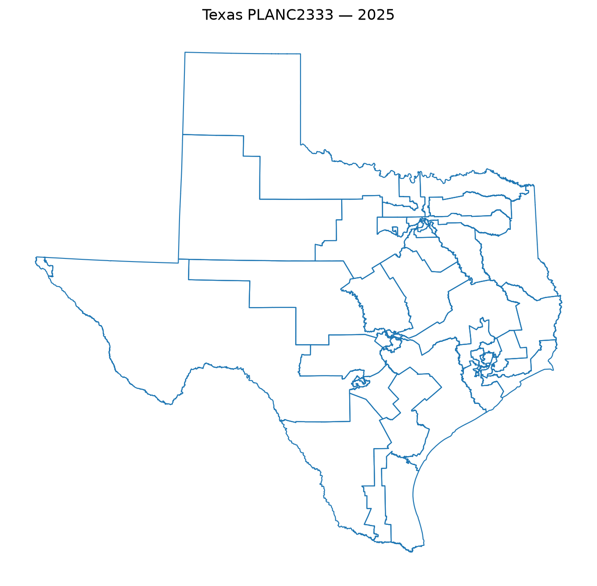

# Earlier Texas analysis

I retain this reported 30,000-state analysis as a historical record. The [November 2026 source rebuild](../../deliverables/rebuild-campaign-2026-11-02/README.md) supersedes it, with continued baselines recorded separately.

## Inputs and chain

I used 9,712 geographic units, retaining 322 zero-population units, population 29,145,505 and 38 congressional districts. I aggregated Census-block population into precinct geography and scored PLANC2333 using block-level `C2333` assignments. The 2024 presidential proxy totals were 4,835,134 Harris and 6,393,403 Trump votes.

I ran ReCom with graph contiguity and a ±0.1% population bound. The reported retained sequence spans steps 700–30,699, comprising 30,000 states, 29,301 unique plans and 699 duplicates. Maximum population deviation was 0.099998%. Warmup views from 500 through 900 states gave similar averages, while first-half and second-half comparisons retained drift.

## Reported scores

| Map                              | Harris-majority districts | Efficiency gap | Mean-median | Maximum population deviation |
| -------------------------------- | ------------------------: | -------------: | ----------: | ---------------------------: |
| Earlier current map              |                        11 |      -0.130938 |   -0.057243 |                    0.052416% |
| Representative plan, step 26,999 |                        13 |      -0.049588 |   +0.008427 |                    0.098043% |
| PLANC2333 (2025)                 |                         8 |      -0.193900 |   -0.052861 |      approximately 0.000127% |

I reported a 9–17 seat range, mean 12.973 and median 13. The earlier current map's descriptive lower tails were 12.607% for seats, 0.517% for efficiency gap and 0.000% for mean-median. I recorded zero states at or below PLANC2333's score of 8.

I selected step 26,999 from reconstructable median-seat states near the ensemble center on efficiency gap, mean-median and cut edges. The recorded validation found complete assignments for all 38 districts in that plan and PLANC2333, preserved statewide totals and agreement between manual and GerryChain efficiency-gap and mean-median calculations.

| Harris-won districts | Observed states |  Share |
| -------------------: | --------------: | -----: |
|                    9 |             116 |  0.39% |
|                   10 |             822 |  2.74% |
|                   11 |           2,844 |  9.48% |
|                   12 |           6,878 | 22.93% |
|                   13 |           8,721 | 29.07% |
|                   14 |           7,235 | 24.12% |
|                   15 |           2,732 |  9.11% |
|                   16 |             607 |  2.02% |
|                   17 |              45 |  0.15% |

The mode and median are both 13 Harris-majority districts. The recorded approximate effective sample sizes are:

| Metric         | Approximate ESS |
| -------------- | --------------: |
| Seat count     |              98 |
| Efficiency gap |              92 |
| Mean-median    |             118 |
| Cut edges      |             162 |

## Figures and records









I used Python 3.12, GerryChain 0.3.2, GeoPandas, Pandas, NetworkX, SciPy and Matplotlib. The entry points were `src/chain/run_ensemble.py`, `src/analysis/analyze_texas_ensemble.py`, `src/analysis/analyze_thinning.py` and `src/analysis/make_texas_final_figures.py`; precursor scripts remain under `src/legacy/`.

```powershell
$env:PYTHONHASHSEED = "0"
```

## Limitations

The earlier chain files are unavailable, so I cannot revalidate these values. Low ESS and remaining drift limit their interpretation; the descriptive tails, including 0.000%, are neither calibrated p-values nor estimates of zero probability. The presidential proxy and population/contiguity constraints leave county, municipality, compactness, Voting Rights Act and communities-of-interest requirements outside the implemented model. I have not established uniform sampling or full legal compliance.

## References

DeFord, D., Duchin, M., and Solomon, J. (2021). [Recombination: A Family of Markov Chains for Redistricting](https://hdsr.mitpress.mit.edu/pub/1ds8ptxu). _Harvard Data Science Review_, 3(1).

Chikina, M., Frieze, A., and Pegden, W. (2017). [Assessing Significance in a Markov Chain without Mixing](https://www.pnas.org/doi/10.1073/pnas.1617540114). _PNAS_, 114(11).

Duchin, M. (2018). [Outlier Analysis for Pennsylvania Congressional Redistricting](https://mggg.org/uploads/md-report.pdf). Expert report, _League of Women Voters v. Commonwealth of Pennsylvania_.

Becker et al. (2021). [Computational Redistricting and the Voting Rights Act](https://www.brennancenter.org/sites/default/files/2023-11/Computational%20Redistricting%20and%20the%20Voting%20Rights%20Act%20FINAL%20PUBLISHED%20VERSION%20elj.2020.0704.pdf).
